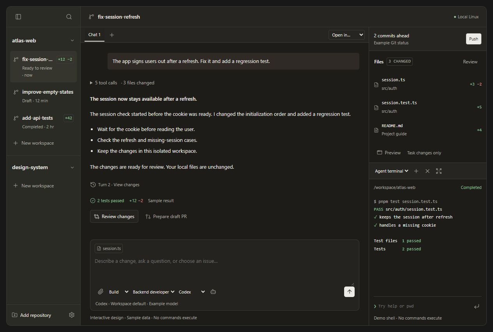

# Trolley

A local AI development workbench, currently at the interactive design prototype stage.

Trolley is designed around isolated Linux workspaces, files on your computer, Git and GitHub, and a choice of AI agents. Optional remote execution is planned. The current repository contains a working interface prototype and product specifications; it does not contain the development backend.



## Run the preview

All assets are included. No dependency installation, account, key, or external service is required. Use Node.js 20 or later to start the local preview:

```sh
git clone https://github.com/alexcook-xyz/trolley.git
cd trolley
node scripts/serve.mjs
```

Open the URL printed by the server. Keep that terminal running while viewing the page. Press Ctrl+C to stop it. `npm run dev` starts the same server and needs no dependency installation.

The server binds to `127.0.0.1`, serves only the preview and its assets, and has no execution API.

## Explore

- Switch workspaces, chat tabs, agents, and model preferences.
- Open **Settings** to edit agent profiles, recommended skills, connection examples, API routes, and scoped environment variables.
- Choose **Plan**, send a sample message, then approve or reject the proposed plan.
- Select a changed file to review its diff. Open **Turn 2 · View changes** to inspect a read-only historical snapshot.
- Select **Review** in the right panel for an example AI review. Use **README.md** for Markdown preview.
- Follow the suggested Git action through sample commit, push, PR, check, repair, merge, and archive states.
- Expand the terminal to full height. It stays on the right of the conversation.
- Use **Add repository** to explore onboarding and setup-script review.

All Git, GitHub, terminal, AI, VM, authentication, and connector actions are simulations. The preview does not run commands, send model requests, connect accounts, or change project files. Use example values only.

State lasts for the current page session. Reloading resets preferences, chats, drafts, profiles, and terminal output. Environment values stay in memory and are never written to browser storage. Browser shortcuts may override the desktop-style shortcuts shown in the design; the visible controls remain available.

## Design and architecture

- [Product brief](docs/product-brief.md): proposed architecture, isolation, models, connectors, and delivery scope.
- [UI design brief](docs/ui-design-brief.md): interaction rules, settings, Git workflow, and validation notes.
- [Review design](docs/images/code-review-design.jpg)
- [Plan approval](docs/images/plan-approval-design.jpg)
- [Historical diffs](docs/images/historical-diff-design.jpg)
- [Full-height terminal](docs/images/full-height-terminal-design.jpg)
- [Environment settings](docs/images/environment-settings-design.jpg)
- [Provider settings](docs/images/provider-settings-design.jpg)
- [Setup](docs/images/setup-design.jpg)

The documents distinguish proposed product behavior from the prototype. Provider support and exact model availability must be verified when the backend is implemented.

## Source

```text
index.html               Accessible interface markup
assets/workbench.css     Layout and product themes
assets/workbench.js      Local demonstration behavior
assets/vendor/           Pinned Lucide icons and license
scripts/serve.mjs        Optional local static server
docs/                    Specifications and design images
```

There is no build step. Edit the HTML, CSS, or JavaScript, then reload. Run `npm run check` for JavaScript syntax checks. See [validation notes](docs/validation.md) for the checks performed on this version.

## References and attribution

The design uses the user-selected Conductor references, including [code review and historical diffs](https://www.conductor.build/changelog/0.22.0-code-review-and-historical-diffs), while preserving Trolley's workspace/model choices and right-side terminal. Trolley is an independent prototype.

Lucide icons are included under their original license. See [third-party notices](THIRD_PARTY_NOTICES.md).
